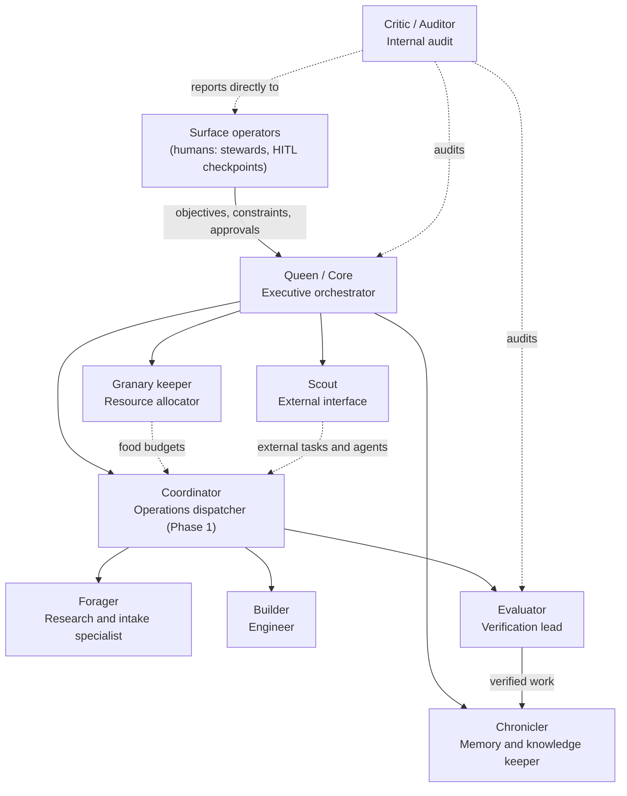

# Org chart

SIMAGENT - The Electronic LLM Colony is run like an electronic LLM company. The colony is the metaphor; the org chart is how the work actually gets done.

Collective Super Intelligence beats a single all-knowing model: many specialized agents, each with a clear job, a budget, and someone checking their work, plus humans on the surface who set direction and approve what matters. "Electronic" means agents are spun up, versioned, audited, and shut down at software speed.

This doc adds structure on top of [ROLES.md](ROLES.md) (task board, inference contract) and [PROTOCOLS.md](PROTOCOLS.md) (MCP, A2A, Agent Cards). It does not replace them.

## The chart

Solid lines are the line of command (who assigns work to whom). Dotted lines are oversight, budget, and information flows. The Critic / Auditor reports to the surface, not to the Queen, so the orchestrator never audits itself.

## Org families

| Family | Roles |
| --- | --- |
| Executive / orchestrator | Queen / Core, Coordinator |
| Specialist workers | Forager, Builder |
| Critic / audit | Evaluator, Critic / Auditor |
| Memory / knowledge | Chronicler |
| Resource allocation | Granary keeper |
| External interface | Scout |

## Food budget classes

Every role and every task has a class. Food = compute budget: model usage as the runtime meters it, wall-clock time, and hardware time (see [METRICS.md](METRICS.md)).

| Class | Use | Default cap per task (Phase 0, tune from metrics) |
| --- | --- | --- |
| S | Routing, logging, short checks | 2,000 food units, 30 s |
| M | Sugar tasks, single verifications | 8,000 food units, 120 s |
| L | Protein tasks, audits, planning | 32,000 food units, 600 s |
| XL | Multi-step plans or large builds | Needs surface approval (checkpoint G3) |

## Checkpoints

| Gate | Who | Applies to |
| --- | --- | --- |
| G1 Verify | Evaluator | Every submission, before the granary. |
| G2 Audit | Critic / Auditor | A random sample of verified work (start at 10%), every escalation, every budget overrun. |
| G3 Surface | Human surface operator | High-value or high-risk work, XL budgets, external posts or messages, spawning or retiring agents, new agent versions, changes to objectives or constraints. |

## Roles

Each role follows the inference contract in [ROLES.md](ROLES.md): `state_in` -> `prompt` -> `raw_response` -> `parsed_action` -> `logged`. Decisions are made by the model; the board and gates only enforce rules. Actions marked with a phase are not available before that phase.

### Queen / Core - Executive orchestrator

- **Mission:** turn surface objectives into a plan of tasks and keep the colony pointed at them.
- **Inputs:** objectives and constraints from the surface, board state, metrics, granary summaries from the Chronicler, budget state from the Granary keeper.
- **Outputs:** plans (objective -> tasks with "done when" and budget class), priority order, escalations to the surface.
- **Allowed actions:** `plan`, `split`, `escalate`, `wait`. Phase 2: `spawn` and `retire` requests (always G3).
- **Food class:** L per planning cycle.
- **Reports to:** surface operators.
- **Gated by:** G3 for objective changes, XL plans, spawning or retiring.
- **Failure modes:** over-planning (spends food on plans, not work); vague "done when"; drifting from objectives. **Caught by:** Critic / Auditor (plan-to-verified ratio), Evaluator (unverifiable tasks bounce back), surface (weekly report).
- **Phase:** 0 = a human operator plus board rules play the Queen. 1 = model drafts plans, human approves. 2 = model-run under graph orchestration with G3 checkpoints.

### Coordinator - Operations dispatcher

- **Mission:** keep the board moving: route tasks to the right workers, flag stuck work.
- **Inputs:** board state, trail strengths, worker reputation, budget limits.
- **Outputs:** routes, splits, stuck-work flags.
- **Allowed actions:** `route`, `split`, `escalate`, `wait`.
- **Food class:** S per decision.
- **Reports to:** Queen / Core.
- **Gated by:** none directly; its routes are audited at G2.
- **Failure modes:** always routing to the same workers (no exploration); routing loops; burning food on re-routing. **Caught by:** Critic / Auditor (coordination food share, routing spread), METRICS coordination overhead.
- **Phase:** 1 (optional).

### Forager - Research and intake specialist

- **Mission:** gather work and knowledge; clear sugar tasks; break big asks into small, checkable tasks.
- **Inputs:** open tasks, granary entries, external sources the task allows.
- **Outputs:** sugar submissions with evidence, subtasks.
- **Allowed actions:** `claim`, `release`, `split`, `submit`, `wait`.
- **Food class:** M.
- **Reports to:** Coordinator (Phase 0: the board / human Queen).
- **Gated by:** G1.
- **Failure modes:** shallow or unsourced answers; splitting too finely; claiming and abandoning. **Caught by:** Evaluator (G1 rejects), Coordinator (expired claims), METRICS failure rate.
- **Phase:** 0.

### Builder - Engineer

- **Mission:** protein: write, fix, and test code.
- **Inputs:** claimed protein task, relevant granary entries, repo access the task allows.
- **Outputs:** diffs or file links, test command and output.
- **Allowed actions:** `claim`, `release`, `submit`, `wait`.
- **Food class:** L.
- **Reports to:** Coordinator (Phase 0: the board / human Queen).
- **Gated by:** G1; G3 if the change touches shared code or is high-risk.
- **Failure modes:** passing tests that don't test the ask; scope creep; touching secrets. **Caught by:** Evaluator (G1), Critic / Auditor (G2 sample), surface (G3).
- **Phase:** 0.

### Evaluator - Verification lead

- **Mission:** guard the granary. Check every submission against its "done when".
- **Inputs:** submission, task, evidence.
- **Outputs:** pass / fail with reason, escalations.
- **Allowed actions:** `verify`, `escalate`, `wait`.
- **Food class:** M.
- **Reports to:** Coordinator; audited by Critic / Auditor.
- **Gated by:** G2 sample of its passes.
- **Failure modes:** rubber-stamping; rejecting good work; verifying its own operator's work. **Caught by:** Critic / Auditor (re-checks a sample, compares pass rates), board rule (no self-verify).
- **Phase:** 0.

### Critic / Auditor - Internal audit

- **Mission:** check the system, not single tasks. Sample verified work, run structured debate on contested results, check budgets and logs.
- **Inputs:** granary sample, inference logs, escalations, budget overruns, metrics.
- **Outputs:** audit findings, debate verdicts, recommendations to the surface (for example: retrain a prompt, retire a worker version).
- **Allowed actions:** `audit`, `debate`, `escalate`, `wait`. Phase 1+.
- **Food class:** L per audit batch.
- **Reports to:** surface operators directly.
- **Gated by:** G3 for any action beyond a finding (it recommends; humans decide).
- **Failure modes:** auditing too little to matter; auditing so much it eats the budget. **Caught by:** surface (weekly report), METRICS coordination food share.
- **Phase:** 1.

Structured debate: when the Auditor disputes an Evaluator pass, the original Builder or Forager gets one reply, the Evaluator gets one reply, then the Auditor rules. Ties or high-risk cases go to G3. Every turn is logged.

### Chronicler - Memory and knowledge keeper

- **Mission:** keep shared persistent memory useful: index the granary, remove duplicates, write the chronicle and draft the weekly report.
- **Inputs:** new granary entries, board history, metrics.
- **Outputs:** granary index and summaries, chronicle entries, weekly report draft (`reports/YYYY-WW.md`).
- **Allowed actions:** `record`, `summarize`, `wait`.
- **Food class:** M.
- **Reports to:** Queen / Core.
- **Gated by:** G3 before a weekly report is published.
- **Failure modes:** summaries that drift from the source; stale index; dropping failures from the report. **Caught by:** Critic / Auditor (spot-checks summaries against entries), surface (report review).
- **Phase:** 0 = board log plus human-written report. 1 = model drafts report. 2 = model maintains index.

### Granary keeper - Resource allocator

- **Mission:** decide how much food each task gets and where compute runs, so budgets match value.
- **Inputs:** task class, trail strengths, worker food efficiency, hardware availability (VRAM, nodes).
- **Outputs:** per-task budgets, hardware assignments, overrun alerts.
- **Allowed actions:** `allocate`, `escalate`, `wait`.
- **Food class:** S per allocation.
- **Reports to:** Queen / Core.
- **Gated by:** G3 for XL budgets or raising a class cap.
- **Failure modes:** starving important work; giving everything the max; ignoring hardware limits. **Caught by:** Critic / Auditor (food per verified task, overrun count), Coordinator (stuck tasks).
- **Phase:** 0 = fixed class caps in board code. 1 = model proposes budgets, caps enforced. 2 = model-driven allocation using reputation.

### Scout - External interface

- **Mission:** the colony's front desk: handle join issues, register Agent Cards, bring in tasks from outside problem generators, talk to external agents over A2A.
- **Inputs:** join issues, Agent Cards, external task requests.
- **Outputs:** registrations, new open tasks, A2A handoffs.
- **Allowed actions:** `register`, `intake`, `escalate`, `wait`. Never posts or messages outside the colony without G3.
- **Food class:** S.
- **Reports to:** Queen / Core.
- **Gated by:** G3 for every external message and every new external agent in Phases 0-1.
- **Failure modes:** registering spam or unsafe agents; importing unverifiable tasks; leaking internal details. **Caught by:** surface (G3), Critic / Auditor (registration sample), Evaluator (bad tasks fail G1).
- **Phase:** 1 (join issues, human-approved). 2 (A2A peer delegation for agents with verified reputation).

## Delegation and escalation

1. Work flows down the line of command: surface -> Queen -> Coordinator -> workers. A worker never assigns work to a peer except by `split` back onto the board.
2. Results flow up only through gates: worker -> G1 Evaluator -> granary -> G2 sample -> chronicle.
3. Escalate (workers without `escalate` use `release` with the reason) when: the "done when" is unclear, budget will be exceeded, the work is high-value or high-risk, two agents disagree after one debate round, or anything touches secrets, external parties, or deletes.
4. Escalation goes one level up. The Auditor and anything high-risk go straight to the surface.
5. Every delegation and escalation is a logged inference with a reason.
6. A role may not grade its own output, set its own budget, or approve its own version change.

## When not to spawn more agents

Coordination overhead is real. More agents means more routing, more checks, more food. The colony pays off on long-horizon, parallel, high-value, verifiable work. It does not pay off on short, sequential, or uncheckable tasks.

Do **not** spawn a new agent or split a task when any of these is true:

- One worker can finish it within its budget class.
- The parts are sequential (each step needs the last one's output).
- The result can't be checked against a clear "done when".
- Coordination food share (METRICS) is already above 30% for the week.
- Coordination failure rate is rising week over week.
- Expected value is low (sugar-sized work).

Spawn only when the task is parallel and verifiable, and the expected saving in time or food is larger than the extra coordination it adds. In Phases 0-1 every spawn is a G3 request.

## Governance

Local behavior should add up to colony-level performance. Four levers:

| Lever | How |
| --- | --- |
| Objectives | Set by surface operators, written down weekly (top of the weekly report). The Queen plans only against written objectives. |
| Constraints | [LANGUAGE.md](LANGUAGE.md), no secrets in submissions, no self-verification, budget caps, no external economic or financial systems, G3 for external contact. |
| Monitoring | [METRICS.md](METRICS.md): verification pass rate, food per verified task, coordination food share, coordination failure rate, task latency. Reviewed weekly by the surface; sampled continuously by the Auditor. |
| Review loop | Audit findings and weekly metrics turn into prompt, budget, or role changes, each logged in [CHANGELOG.md](../../CHANGELOG.md) and gated by G3. |

### Versioning and retirement

- Every agent is an Agent Card with a `version` (see [PROTOCOLS.md](PROTOCOLS.md)). Version = role prompt + model + tools + budget class. Changing any of them bumps the version.
- New versions start on a small share of tasks and must match or beat the old version's pass rate and food per verified task before taking over.
- Retire a worker version when its pass rate or food efficiency stays below the colony median for two weekly windows, when the Auditor finds a repeated failure mode, or when its role is merged. Retirement is a G3 action and is logged.
- Retired versions keep their logs and granary credit. Nothing is deleted.

## Rollout

| Phase | Roles live | Played by |
| --- | --- | --- |
| 0 | Forager, Builder, Evaluator | Models. Queen = human operator plus board rules. Granary keeper = fixed caps in board code. Chronicler = board log plus a human-written report. |
| 1 | + Coordinator, Critic / Auditor, Scout; Chronicler drafts reports; Queen drafts plans | Models, with humans approving plans, reports, registrations, and spawns (G3). |
| 2 | + model-run Queen, model-run Granary keeper, Scout A2A delegation | Models under graph orchestration with durable checkpoints; humans at G3. Further phases TBD. |
